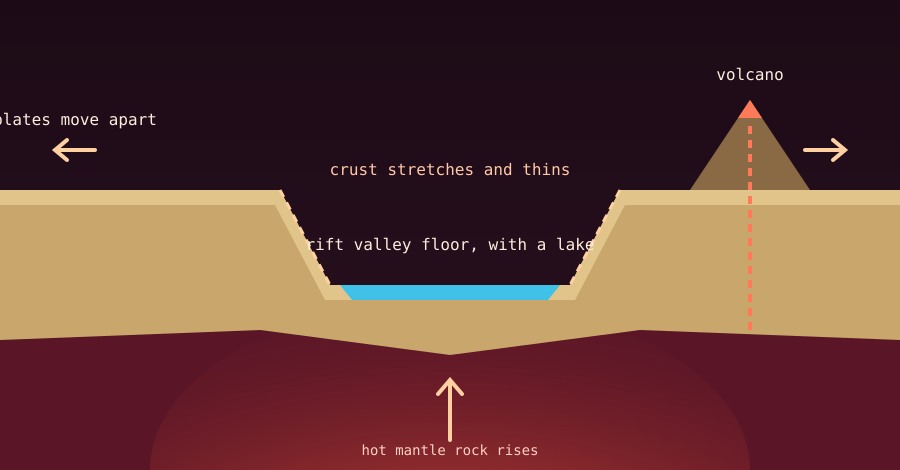

The **East African Rift System** is a vast, active fracture zone about 6,400 kilometres long, running through eastern Africa. It is like a giant zipper along which the African continent is slowly tearing into two pieces.

{fig-alt="Cross-section of a rift valley: stretched, thinned crust, a sunken valley floor with a lake between fault cliffs, a volcano on one side and hot mantle rock rising below."}

Most places where continents pull apart (**divergent boundaries**) lie deep underwater. The East African Rift is special because it is happening on dry land, giving us a rare view of how new oceans begin. See also [how oceans and mountains form](oceans-and-mountains-formation.qmd).

## How the rift works

Deep below, a broad upwelling of hot mantle rock, often called the African Superplume, heats, stretches and thins the continental crust above it, like a blowtorch under a slab of wax.

As the ground stretches, the African Plate is splitting into two main pieces:

- **Nubian Plate:** the larger piece to the west, holding most of Africa.
- **Somali Plate:** the smaller piece to the east, holding the Horn of Africa and the coast.

They are moving apart very slowly, at roughly 2 to 7 millimetres a year, about as fast as fingernails grow. Geologists also recognise a few small microplates in between.

## The landscape it creates

Because the land is pulling apart, the middle blocks drop while the edges rise. This builds some of Earth's most dramatic scenery:

- **Rift valleys:** the sunken central floor forms the classic Rift Valley, bounded by steep cliffs called fault scarps.
- **Volcanoes:** thin crust lets magma reach the surface. Erta Ale, in Ethiopia, has a long-lived lava lake. Famous peaks such as Mount Kilimanjaro and Mount Kenya also stand in the rift region.
- **Deep lakes:** long, narrow depressions on the valley floor fill with water, forming very deep lakes such as Lake Tanganyika and Lake Malawi.

## How far along is the split?

Studies of the region near Lake Turkana in Kenya report that the crust has thinned to about 13 kilometres, compared with a typical 35 kilometres. Geologists call this stage "necking", like a pulled candy bar thinning just before it snaps. Parts of the rift are among the best places on Earth to study a continent in this late stage of breaking apart.

## The fate of Africa

There is no need to worry: this takes millions of years. Some projections suggest that in roughly 5 to 10 million years:

1. the rift valley floor could sink below sea level,
2. seawater from the Red Sea and the Indian Ocean could flood the basin, and
3. a new ocean would form, leaving the Somali Plate as a large island continent in the Indian Ocean.

These timescales are estimates and vary between studies.

## Related reading

- [How oceans and mountains form](oceans-and-mountains-formation.qmd)
- [Tectonic faults in simple terms](tectonic-faults-explained.qmd)
- [Major tectonic plates and subplates](major-tectonic-plates.qmd)

## Sources

- [East African Rift System, Britannica](https://www.britannica.com/place/East-African-Rift-System)
- [East African Rift Valley, Geological Society](https://www.geolsoc.org.uk/science-and-policy/plate-tectonic-stories/east-african-rift-valley/)
- [Eastern Africa is splitting apart, but not where we expected, Eos](https://eos.org/articles/eastern-africa-is-splitting-apart-but-not-where-we-expected)
- [East African Rift, Wikipedia](https://en.wikipedia.org/wiki/East_African_Rift)
- [Turkana rift, Discover Wildlife](https://www.discoverwildlife.com/environment/turkana-rift-east-africa)
- [USGS Open-File Report 2010-1083](https://pubs.usgs.gov/publication/ofr20101083P)
