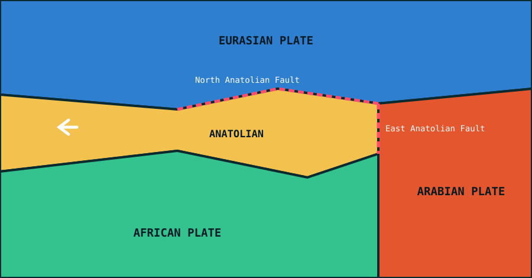

**No. Turkey is not on the European tectonic plate.**

Geologically, most of Turkey sits on the **Anatolian plate**. It is part of the wider Eurasian plate system and the Alpide belt. A small southern sliver lies on the **Arabian plate**.

{fig-alt="The Anatolian plate squeezed westward between the Eurasian, African and Arabian plates, with the North and East Anatolian faults marked."}

## Tectonic setting

The Anatolian plate is squeezed and pushed westward and southwestward between the larger Eurasian, African and Arabian plates.

## Geography vs. tectonics

Only about 3% of Turkey's land, East Thrace, lies geographically in southeastern Europe. The underlying geology is a different matter. Active fault lines such as the North Anatolian and East Anatolian fault zones belong to the Anatolian/Eurasian collision zone, not to a distinct "European plate".

## Related reading

- [Does Europe have its own tectonic plate?](europe-tectonic-plate.qmd)
- [Tectonic faults in simple terms](tectonic-faults-explained.qmd)

## Sources

- [Geography of Turkey, Wikipedia](https://en.wikipedia.org/wiki/Geography_of_Turkey)
- [Turkey, Britannica](https://www.britannica.com/place/Turkey)
- [Why is Turkey not considered a part of Europe despite being geographically located in both Europe and Asia? Quora](https://www.quora.com/Why-is-Turkey-not-considered-a-part-of-Europe-despite-being-geographically-located-in-both-Europe-and-Asia)
