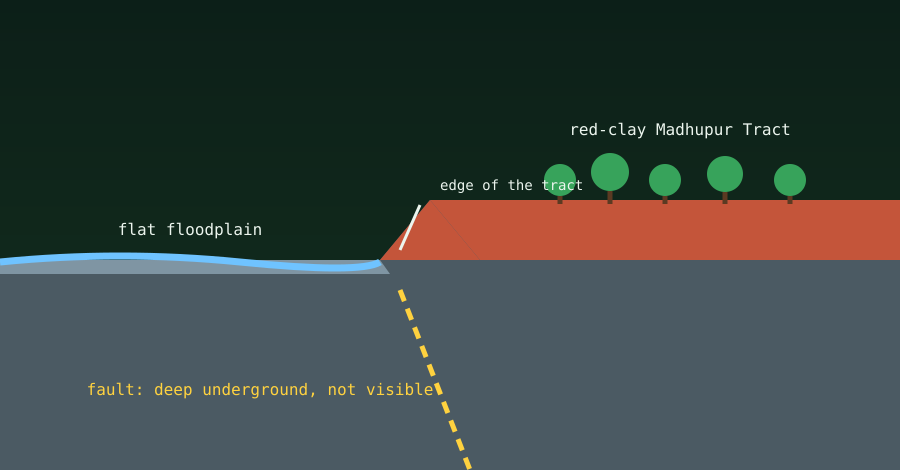

**No. You cannot see the Madhupur Fault itself.** It is a subsurface structure covered by thick layers of soil. What you *can* see is its imprint on the landscape: the shapes of the land and rivers that the fault has helped create.

{fig-alt="Cross-section showing a raised red-clay plateau beside a flat river floodplain, with the fault buried deep underground."}

Instead of an open rocky canyon, the fault shows up through sharp contrasts in the land.

## 1. The red-clay highlands

Travel from the low river plains around Dhaka or Mymensingh towards Gazipur or Tangail and you will notice a change in height and soil colour. The **Madhupur Tract** is a raised plateau of iron-rich, oxidised red and brown clay. Studies link its uplift to movement along the fault over a very long time.

## 2. The edge of the tract

The most visible clue is the western edge of the tract, near places such as Ghatail, Madhupur and parts of Mirpur in Dhaka. There the ground steps down, and from the red clay you can look out over the flat, grey alluvial floodplain of the Jamuna-Brahmaputra system. This step looks like a fault scarp. Researchers still debate how much of it was made by the fault, so treat it as a clue, not proof.

## 3. Diverted rivers

Uplift of this block has also shaped the rivers. The raised tract acted like a wall, and the Old Brahmaputra and Jamuna rivers shifted their channels to flow around it.

## What is hidden, what is visible

- **Hidden:** the fault itself, deep underground, where the blocks of rock grind past each other.
- **Visible:** Sal forests on red soil standing on higher ground, right beside low, flat paddy fields.

## Related reading

- [Tectonic faults in simple terms](tectonic-faults-explained.qmd)
- [Major tectonic plates and subplates](major-tectonic-plates.qmd)

## Sources

- [Madhupur Tract, Banglapedia](https://en.banglapedia.org/index.php?title=Madhupur_Tract)
- [Tectonics of Madhupur Tract and its influence on the Cenozoic sediments and Jamuna River avulsion, ResearchGate](https://www.researchgate.net/publication/349494257_Tectonics_of_Madhupur_Tract_and_its_Influence_on_the_Cenozoic_Sediments_and_Jamuna_River_Avulsion)
- [Madhupur fault puts Bangladesh at high quake risk, Dhaka Tribune](https://www.dhakatribune.com/bangladesh/nation/325841/madhupur-fault-puts-bangladesh-at-high-quake-risk)
- [Dhaka's earthquake danger ignored for too long, Asia News Network](https://asianews.network/dhakas-earthquake-danger-ignored-for-too-long/)
- [Madhupur Fault at high quake risk, Bangladesh Post](https://bangladeshpost.net/posts/madhupur-fault-at-high-quake-risk-tangail-people-highly-alarmed-164332)
