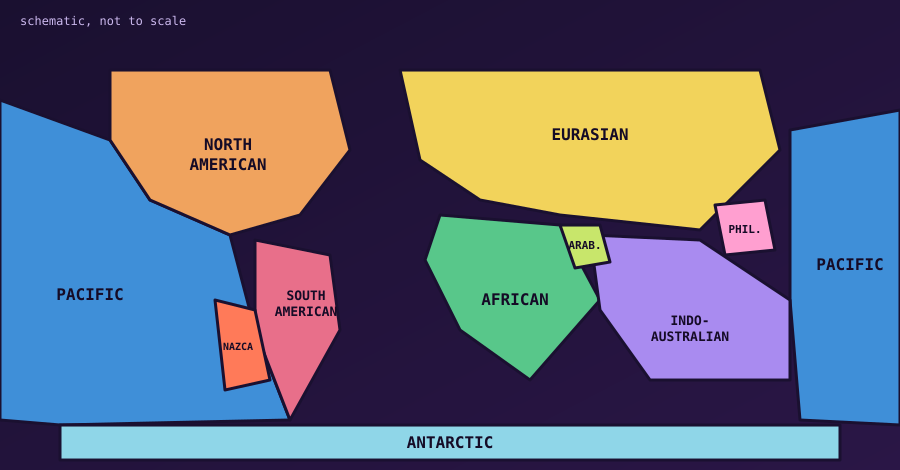

The Earth's lithosphere is broken into 7 or 8 major tectonic plates, depending on how they are classified, and dozens of smaller minor plates, or microplates.

{fig-alt="Simplified world map showing the Pacific, North American, South American, Eurasian, African, Indo-Australian and Antarctic plates, plus the Nazca, Arabian and Philippine Sea plates."}

## Major plates

These plates cover roughly 94% of the Earth's surface and carry entire continents and oceans.

| Plate | What it covers |
|---|---|
| Pacific | The largest plate, under most of the Pacific Ocean, ringed by the volcanic "Ring of Fire". |
| North American | North America, Greenland, and parts of the Atlantic and Arctic oceans. |
| Eurasian | The second largest: most of Europe and Asia, and part of the Atlantic. |
| African | The whole African continent and large parts of the Atlantic and Indian oceans. |
| Antarctic | Antarctica and the Southern Ocean around it. |
| Indo-Australian | India, Australia and the oceans between. Often treated as two plates, Indian and Australian, which fused millions of years ago. |
| South American | South America and the southwestern Atlantic. |

## Minor plates and subplates

These smaller plates fill the gaps between the major ones. Despite their size, their interactions drive intense earthquake and volcanic activity, especially in the Mediterranean and around the Pacific.

### The Americas and the Caribbean

- **Nazca:** a very active oceanic plate subducting under western South America.
- **Cocos:** beneath the Pacific Ocean off Central America.
- **Juan de Fuca:** a small remnant plate subducting under the US Pacific Northwest.
- **Caribbean:** wedged between North and South America, under the Caribbean Sea.

### The Mediterranean and the Middle East

- **Arabian:** dominated by the Arabian Peninsula and pushing north into Eurasia.
- **Anatolian:** a microplate under most of Turkey, squeezed westward.
- **Adriatic (Apulian):** a microplate under parts of Italy and the Adriatic Sea.
- **Aegean Sea:** under southern Greece in the eastern Mediterranean.

### Asia and the Pacific

- **Philippine Sea:** an oceanic plate responsible for deep ocean trenches.
- **Scotia:** in the South Atlantic and Southern Ocean, between South America and Antarctica.
- **Amurian:** parts of northeast China, the Korean Peninsula and western Japan.
- **Okhotsk:** the Kamchatka Peninsula, the Sea of Okhotsk and northern Japan.

## Related reading

- [Does Europe have its own tectonic plate?](europe-tectonic-plate.qmd)
- [Is Turkey part of the European plate?](is-turkey-part-of-european-plate.qmd)
