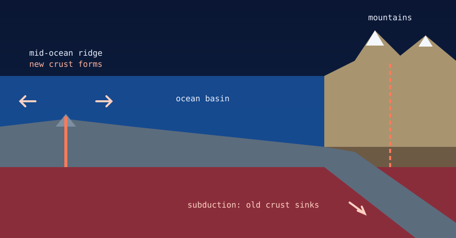

Oceans and mountains are born from the same engine: the cooling, shifting and recycling of Earth's tectonic plates. The Earth's surface area stays fixed, so crust torn apart in one place must be balanced by crust crushed together in another. Oceans open where plates pull apart, and mountains rise where they collide.

{fig-alt="Cross-section: new crust forms at a mid-ocean ridge, and the oceanic plate sinks under a continent where mountains and volcanoes rise."}

## Part 1: How the oceans formed

An ocean needs two things: a giant bowl (the ocean basin) and water to fill it.

1. **Rifting (making the bowl).** Hot rock rises from deep inside the Earth and weakens the continental crust above it. The crust stretches, cracks and pulls apart, a process called rifting. As the land breaks it sinks into a rift valley, like the modern [East African Rift](east-african-rift.qmd).
2. **Seafloor spreading.** As the crust keeps pulling apart, magma wells up into the gap, cools and forms new, dense oceanic crust. Over millions of years the gap widens and pushes the continents apart.
3. **The water.** As the early Earth cooled, billions of years ago, volcanoes released huge amounts of water vapour and gas. The vapour condensed into rain that fell for thousands of years and filled the low-lying basins.

## Part 2: Are oceans and mountains related?

Yes. They are two sides of one cycle, known as the **Wilson Cycle**: oceans open, then close, and mountains form as they do.

### The conveyor-belt balance

The Earth cannot grow bigger. If an ocean opens in one place, such as the Atlantic, crust must be destroyed elsewhere. That happens at **subduction zones**, where dense oceanic crust dives beneath a continent. The collision crumples the land upward and feeds volcanoes, building volcanic mountain ranges like the Andes in South America.

### The great crush: when oceans close

Eventually the forces moving the plates change, and an ocean that was widening begins to shrink.

- The seafloor is slowly swallowed back into the Earth.
- The ocean finally disappears, and the continents on either side collide.
- Continental crust is too buoyant to sink, so the two landmasses crumple, fold and thrust upward.

**The best example is the Himalayas.** Millions of years ago the Tethys Ocean separated India from Asia. As India drifted north, the ocean floor was subducted and vanished. When India finally hit Asia, the squeezed crust rose to form the highest mountains on Earth. Marine fossils, such as ancient seashells, are found high in the Himalayas, even near the summit of Mount Everest, because those rocks were once seafloor.

## Oceans vs. mountains

| Feature | Driving force | Crust involved | What happens to the crust |
|---|---|---|---|
| Ocean basins | Divergent (pulling apart) | Oceanic: thin, dense, sits low | New crust forms as magma cools. |
| Mountain ranges | Convergent (pushing together) | Continental: thick, buoyant, sits high | Existing crust is buckled and pushed upward. |

## Related reading

- [What is the East African Rift?](east-african-rift.qmd)
- [Major tectonic plates and subplates](major-tectonic-plates.qmd)
- [Tectonic faults in simple terms](tectonic-faults-explained.qmd)
