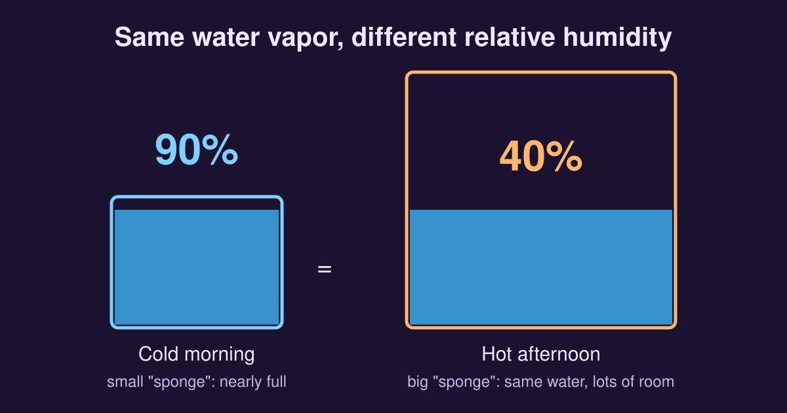

Relative humidity (RH) tells you how much water vapor is in the air compared with the maximum the air could hold at that temperature. It is written as a percentage.

Think of the air as a sponge. A sponge can hold only so much water before it starts to drip.

- **0% RH:** the sponge is bone-dry.
- **50% RH:** the sponge is half full.
- **100% RH:** the sponge is soaked. Add more moisture, or cool the air, and the vapor condenses into dew, clouds, rain or fog.

{fig-alt="Two containers hold the same amount of water. The small one, for cold morning air, is 90 percent full; the large one, for hot afternoon air, is 40 percent full."}

## The catch: it depends on temperature

The word "relative" is the key. How much vapor the air can hold depends on its temperature.

- **Warm air** is a giant sponge, with room for a lot of vapor.
- **Cold air** is a tiny sponge, with room for very little.

So the same amount of vapor gives a very different percentage at different temperatures:

| Time of day | Sponge size | Relative humidity | Feels |
|---|---|---|---|
| Cold morning | Small | about 90% | Damp, dewy or foggy |
| Hot afternoon | Large | about 40% | Much drier |

The water in the air has not changed. The sun has warmed the air, so its capacity has grown and the same vapor fills a smaller share of it.

## Why it matters to us

Relative humidity decides how well sweat can evaporate.

- On a **hot, dry day** (low RH) sweat evaporates quickly, because the air has plenty of room for it. That cools you down.
- On a **sticky, muggy day** (high RH) the air is already nearly full, so sweat clings to your skin. You feel much hotter than the thermometer says.

The same idea explains why winter nights in humid places such as Sylhet turn foggy: as the air cools, its RH climbs towards 100%.

## Related reading

- [Why Is Sylhet Warmer in Winter than Some Other Regions in Bangladesh?](why-sylhet-warmer-in-winter-than-other-regions-in-bangladesh.qmd)
- [Why Sylhet Gets Rain Like Meghalaya](sylhet-meghalaya-rainfall-pattern.qmd)
