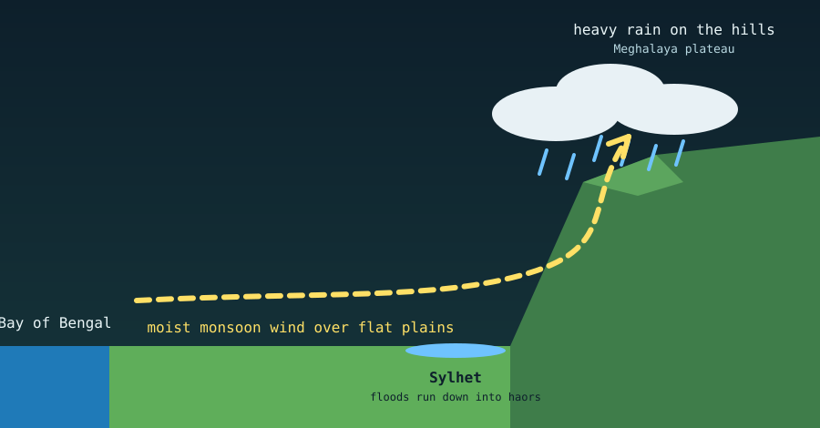

Sylhet in Bangladesh has a rainfall pattern much like that of Meghalaya in India, home of Cherrapunji and Mawsynram. The reason is their shared geography: the same monsoon winds meet the same line of hills, which triggers a process called **orographic precipitation**.

Although an international border separates them, the two regions share one weather system. Sylhet's flat floodplains act as a runway for moist air, and the steep face of the Meghalaya plateau acts as a wall that squeezes the rain out of it.

{fig-alt="Cross-section: moist wind from the Bay of Bengal crosses flat plains, rises over the Meghalaya hills and drops heavy rain, with Sylhet at the foot of the hills."}

## 1. A natural rain machine

From June to September, moisture-laden winds sweep north from the warm Bay of Bengal.

- **The runway.** The winds cross several hundred kilometres of flat Bangladeshi plains with nothing to lift them, so they keep their moisture.
- **The wall.** At the northern edge of the Sylhet division the plain ends suddenly at the southern face of the Meghalaya Plateau (the Khasi and Jaintia Hills), which rises to roughly 1,400 metres near Cherrapunji.
- **The condensation.** The hills force the wind upward. As the air climbs it cools, and cold air holds less water vapour than warm air, so the moisture condenses and falls as heavy rain.

## 2. Why Sylhet gets a share of the downpour

The heaviest rain falls on the hills themselves, at Cherrapunji and Mawsynram, among the wettest places on Earth. But Sylhet sits right at the foot of the same wall.

- **Clouds pile up early.** Before the air has climbed the hills, clouds already build over the Sylhet sky. Funnel-shaped valleys push low, heavy clouds over the north and northeast of the division, around places such as Jaflong, Lalakhal and Kanaighat. This makes Sylhet the wettest region of Bangladesh, with typical annual totals of roughly 3,500 to 5,000 mm, depending on the location.
- **The same seasons.** Both regions have dry, pleasant winters, then a wet pre-monsoon spring and a summer when rain can continue for weeks.

## The consequence: flash floods

Because the rain comes from the same weather event, the two regions share its effects. When Cherrapunji gets an extreme cloudburst, the water cannot soak into the steep, rocky hills. Within hours, huge volumes run off the Indian slopes and rush down into the low-lying **haors** (bowl-shaped wetlands) and rivers of Sylhet, such as the Surma and the Kushiyara, causing severe flash floods.

## Related reading

- [Why is Sylhet warmer in winter?](why-sylhet-warmer-in-winter-than-other-regions-in-bangladesh.qmd)
- [How oceans and mountains form](oceans-and-mountains-formation.qmd)

## Sources

- [Cherrapunji, Wikipedia](https://en.wikipedia.org/wiki/Cherrapunji)
- [Why does Cherrapunji receive exceptionally heavy rain? Britannica](https://www.britannica.com/place/Why-does-Cherrapunji-in-northeastern-India-receive-exceptionally-heavy-rain)
- [Record rain in Meghalaya behind Sylhet floods, Prothom Alo](https://en.prothomalo.com/opinion/interview/record-rain-in-meghalaya-behind-sylhet-floods)
- [Why does the Sylhet region see repeated flooding? Dhaka Tribune](https://www.dhakatribune.com/bangladesh/nation/352004/why-does-the-sylhet-region-see-repeated-flooding)
- [Rise of extreme rainfall behind flash floods in Sylhet, The Daily Star](https://www.thedailystar.net/environment/climate-crisis/natural-disaster/news/rise-extreme-rainfall-behind-flash-floods-sylhet-3635536)
- [Seasonal variation of temperature and rainfall in northeastern Bangladesh around Sylhet, ResearchGate](https://www.researchgate.net/publication/334282917_Seasonal_variation_of_Temperature_and_rainfall_characteristics_in_the_northeastern_part_of_Bangladesh_around_Sylhet)
- [Sylhet climate data, Climate-Data.org](https://en.climate-data.org/asia/bangladesh/sylhet-division/sylhet-3248/)
