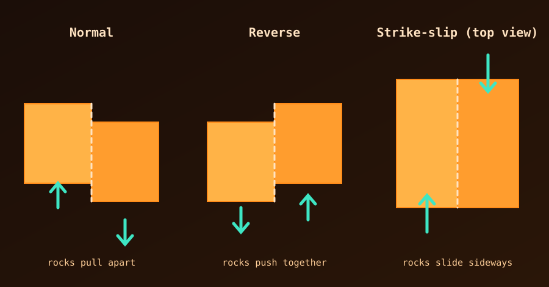

## What is a fault?

A fault is a fracture in the Earth's crust where blocks of rock on either side have moved past one another. Picture the crust as a cracked hard-boiled eggshell. The pieces, the tectonic plates, constantly crowd, rub and pull away from each other, and the active boundaries where they grind together are faults.

Friction can lock the blocks in place, and stress builds up. When the rock finally breaks or slips, the stored energy is released at once as an **earthquake**.

## The three basic types

Faults are classified by the direction the rocks move.

{fig-alt="Block diagrams of normal, reverse and strike-slip faults, with arrows showing how the rock blocks move."}

- **Normal fault:** the rocks pull apart (tension), and one block slides down relative to the other.
- **Reverse (thrust) fault:** the rocks push together (compression), forcing one block up and over the other.
- **Strike-slip fault:** the rocks slide horizontally past one another, like cars passing on a highway.

## Major active fault zones by region

The Earth has millions of small, local cracks. Geologists track the large, highly active fault systems that pose the greatest seismic hazard.

| Region | Notable examples | Main behaviour |
|---|---|---|
| North America | San Andreas Fault, Cascadia Subduction Zone, New Madrid Zone | Large horizontal strike-slip movement in California and strong compression in the Pacific Northwest. |
| South America | Peru-Chile Trench, Boconó Fault | Mostly subduction and reverse faults, where the Pacific floor dives under the continent and lifts the Andes. |
| Mediterranean and Middle East | North Anatolian Fault, East Anatolian Fault, Dead Sea Transform | A dense network of strike-slip and thrust faults as Africa and Arabia push north into Europe. |
| East and South Asia | Main Himalayan Thrust, Altyn Tagh Fault, Sagaing Fault | The densest concentration of continental thrust faults on Earth, driven by India pushing into Asia. |
| Oceania and western Pacific | Alpine Fault (New Zealand), Philippine Fault, Japan Trench | A mix of subduction zones along the "Ring of Fire" and strike-slip faults. |
| East Africa | East African Rift System | Normal faults, as the continent slowly rips apart, forming deep valleys and lakes. |

## Related reading

- [Is Turkey part of the European plate?](is-turkey-part-of-european-plate.qmd)
- [Major tectonic plates and subplates](major-tectonic-plates.qmd)
