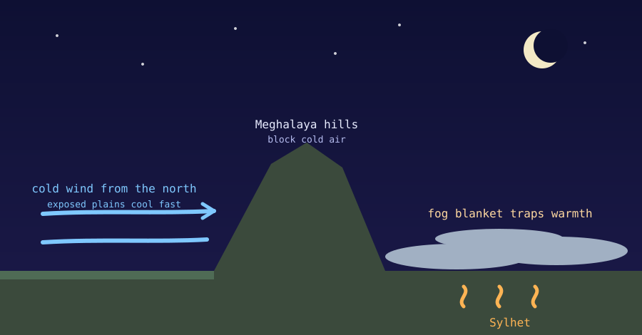

Sylhet is famous for its monsoon rain, but its winters have a quirk too. From December to February Sylhet stays noticeably warmer, especially at night, than the north and northwest of Bangladesh, such as Rangpur, Dinajpur and Rajshahi.

The warmth comes from a mix of topography, wind and geography.

{fig-alt="Cross-section: cold wind from the north is blocked by the Meghalaya hills, while a fog blanket keeps Sylhet warmer at night."}

## 1. The shield of the Meghalaya Plateau

The biggest reason is the Meghalaya Plateau to Sylhet's north.

- Bangladesh's winter cold waves come from chilly winds blowing south from the Himalayan region, the northerly winter monsoon.
- On the way they meet the hills of Meghalaya, which rise above 1,300 metres.
- The plateau acts as a partial shield, blocking or deflecting the lowest and coldest layers of air. Northwestern Bangladesh is open to these cold waves, while Sylhet lies in the shelter of the hills.

## 2. The fog and cloud blanket

Sylhet is a basin full of water: the Surma and Kushiyara rivers and many haors (wetlands). So the ground and air stay moist even in the dry season.

- On winter nights this moisture often condenses into low fog and thin cloud.
- The layer acts like a blanket. It slows the loss of the day's heat to the sky at night (radiational cooling). The drier, flat northwest loses heat quickly after sunset, and temperatures there fall sharply.

## 3. A small advantage of latitude

The harshest winters, at places like Panchagarh and Kurigram, are further north and closer to the Himalayas. Sylhet lies a little further south, so winter sunshine arrives at a slightly higher angle. The effect is small, and it adds to the first two causes instead of replacing them.

## The difference in numbers

In a severe cold wave, night temperatures in the north can fall to about 5–7 °C. Typical winter nights in Sylhet stay much milder, roughly 11–15 °C.

## Sandy ground and hills: what I noticed

I lived in Sylhet for some time, and one thing stayed with me. Winter mornings are often foggy, yet the fog clears early, and the afternoons turn warm and sunny. My guess is that the local ground and the hills play a part:

- **Sandy soils.** Dry sand has a lower heat capacity than wet clay, so it warms quickly in the sun and warms the air just above it. Much of Bangladesh has damp alluvial silt and clay, which warms more slowly.
- **The hills (tilas).** Sloping ground can catch the sun's rays more directly, and higher ground sits above the coldest air that collects in the valleys overnight.

If so, the ground would warm fast in the morning, the air above it would warm too, and the fog would "burn off" sooner than on the damp northern plains, where fog can linger well into the afternoon.

**How well does this hold up?** I checked what I could. It is only partly supported:

- **The geology fits, but "sandy" is too simple.** Sylhet's tilas are made of the Dupi Tila Formation, mixed sandy clays and sandstones. Their soils are described as well-drained, loamy and acidic, not pure sand. Pockets of white sand do exist near the hills.
- **The physics is sound.** Dry, well-drained soil warms faster at the surface than wet clay, because water has a high heat capacity.
- **A caveat.** Sandy ground that heats quickly also tends to cool quickly at night. So it may explain the quick warm-up of the days better than the mild nights, which the hills and fog explain better.
- **I found no study of fog clearing in Sylhet.** That part is only my observation, so I tried a quick data check (below).

## A quick data check

I compared December to February data from 2015 to 2024 for Sylhet and the north (Rangpur, Dinajpur, Saidpur), using two free sources: NOAA station reports (Srimangal stands in for Sylhet) and the Open-Meteo ERA5 model.

- **Nights:** the evidence is mixed. The model gives Sylhet winter lows about 0.7 to 1 °C warmer than the north, but the station data show no clear difference (Srimangal 12.8 °C against 13.0 to 14.4 °C in the north).
- **Days:** both sources show slightly warmer afternoons in Sylhet, and Srimangal has the widest day-night range (13.0 °C against 9.9 to 11.4 °C).
- **Fog:** I found no sign that Sylhet's fog clears earlier. The model clears it around 8 a.m. everywhere, and the station data show Srimangal as foggy as or foggier than the north in the early morning.

**Limits.** Srimangal is about 50 km from Sylhet city and is itself surrounded by hills. The station reports come only every three hours, so they cannot show exactly when fog lifts. ERA5 is a model on a grid of roughly 10 km, and it cannot see tilas or soil. Its fog measure is a rough proxy from humidity. Treat this as a first look, not a test of the sandy-soil idea.

## Related reading

- [Why Sylhet gets rain like Meghalaya](sylhet-meghalaya-rainfall-pattern.qmd)

## Sources

- [Prothom Alo, climate and environment reporting on winter in Bangladesh](https://en.prothomalo.com/environment/climate-change/xwi14steee)
- [Why Bangladesh is seeing such a cold winter, The Daily Star](https://www.thedailystar.net/opinion/views/news/why-bangladesh-seeing-such-cold-winter-3526321)
- [Recent trend analysis of rainfall and temperature over Sylhet region using statistical methods, ResearchGate](https://www.researchgate.net/publication/386506914_RECENT_TREND_ANALYSIS_OF_RAINFALL_AND_TEMPERATURE_OVER_SYLHET_REGION_USING_STATISTICAL_METHODS)
- [Tila, Banglapedia](https://en.banglapedia.org/index.php?title=Tila)
- [Soil characteristics analysis in the Dupi Tila Formation of Sylhet for engineering applications](https://ouci.dntb.gov.ua/works/4VPmoade)
- [NOAA Global Hourly (ISD) data](https://www.ncei.noaa.gov/products/land-based-station/integrated-surface-database)
- [Open-Meteo historical weather API](https://open-meteo.com/en/docs/historical-weather-api)
- [Sylhet climate data, Climate-Data.org](https://en.climate-data.org/asia/bangladesh/sylhet-division/sylhet-3248/)
